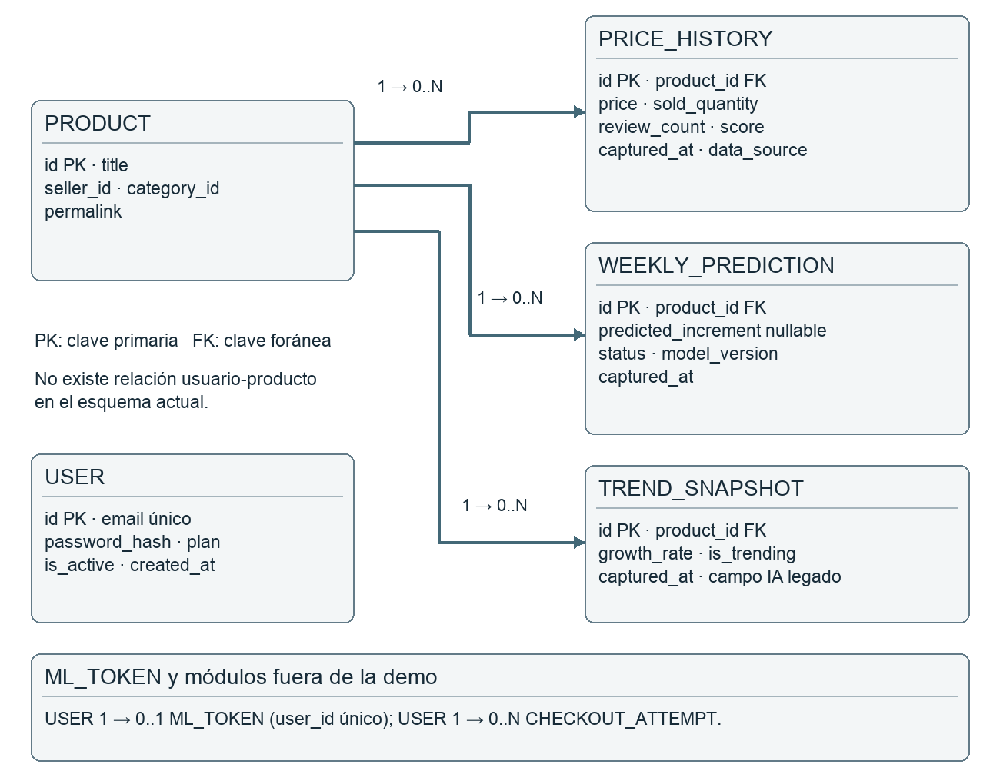
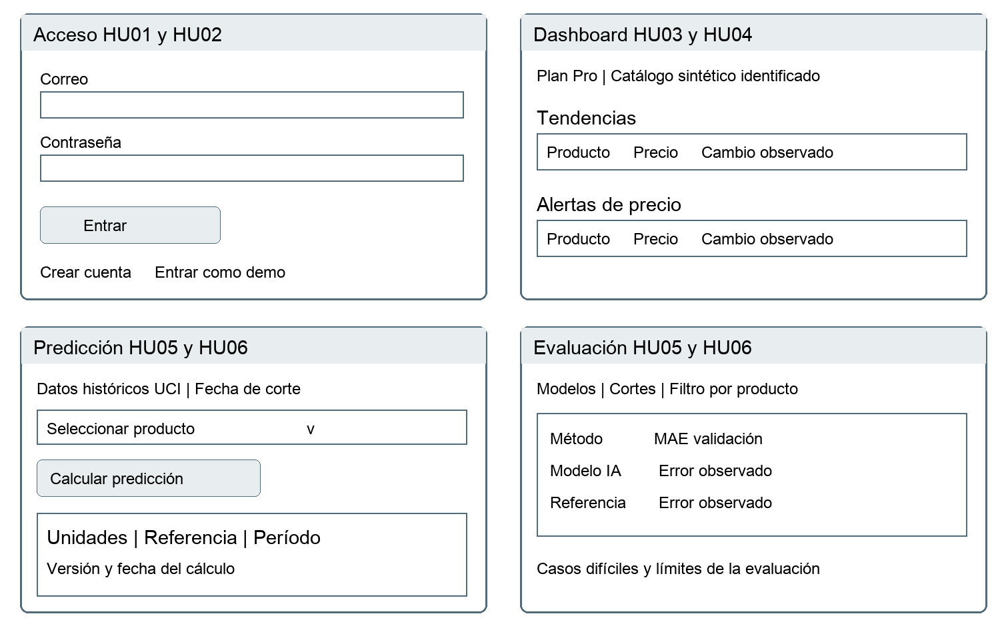
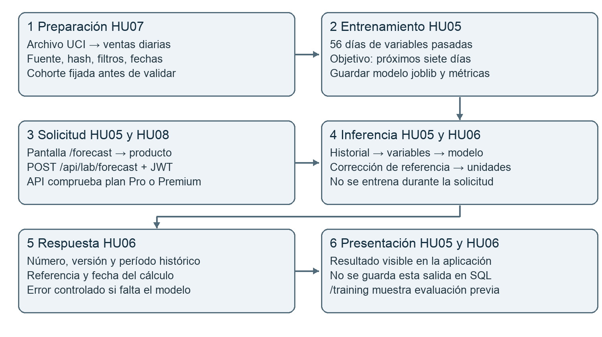
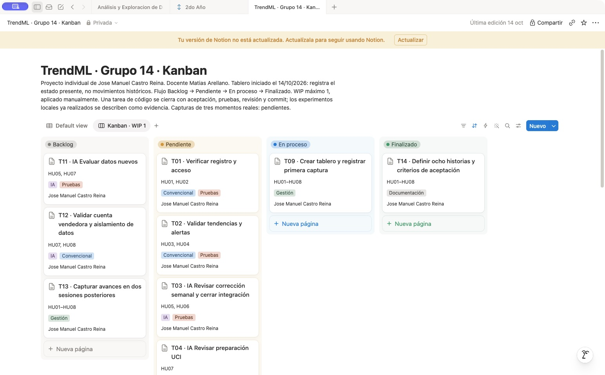
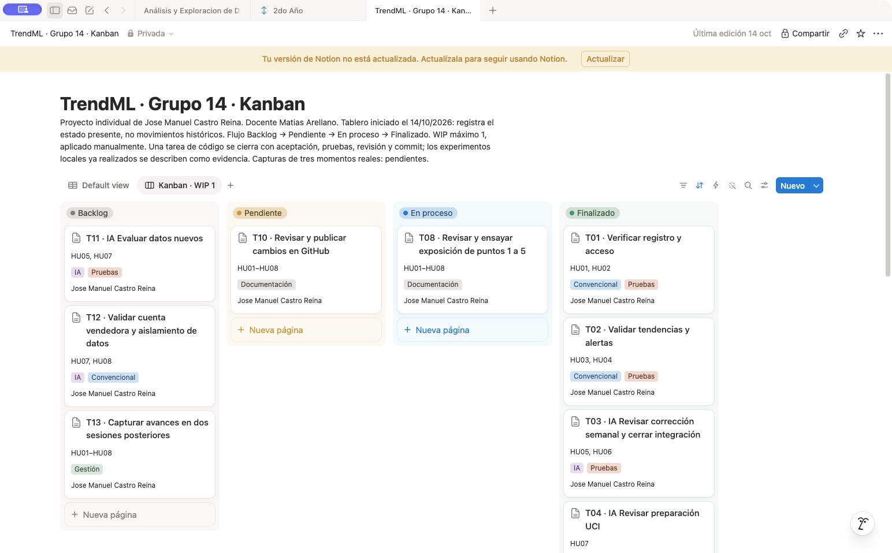
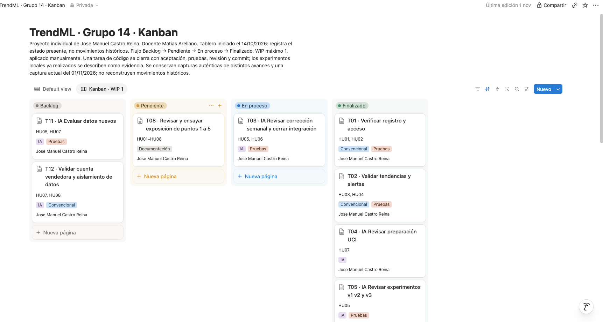

# TrendML — Proyecto integrador

**Jose Manuel Castro Reina** · Grupo 14 · Modalidad individual autorizada<br>
**Docente:** Matias Arellano<br>
**Materia:** Desarrollo de Software con Inteligencia Artificial<br>
**Entrega:** 6 de noviembre de 2026

TrendML es un prototipo académico para consultar tendencias, cambios de precio y ejecutar una estimación semanal de ventas con un modelo de IA. Combina un catálogo sintético claramente identificado con un laboratorio de ventas históricas reales de UCI Online Retail (Reino Unido, 2010–2011).

> **Límite principal:** no es una predicción comercial validada para Mercado Libre ni para ventas actuales. El resultado del modelo es una estimación de desarrollo que requiere revisión humana.

---

## Contenido

1. [Revisión rápida](#1-revisión-rápida)
2. [Cómo levantar el proyecto](#2-cómo-levantar-el-proyecto)
3. [Funcionalidades e historias de usuario](#3-funcionalidades-e-historias-de-usuario)
4. [Metodología ágil y gestión](#4-metodología-ágil-y-gestión)
5. [Diseño del sistema](#5-diseño-del-sistema)
6. [Integración de la IA](#6-integración-de-la-ia)
7. [Datos, variables y entrenamiento](#7-datos-variables-y-entrenamiento)
8. [Pruebas y resultados](#8-pruebas-y-resultados)
9. [Registro y análisis del uso de IA](#9-registro-y-análisis-del-uso-de-ia)
10. [Tablero Kanban y evidencias](#10-tablero-kanban-y-evidencias)
11. [Repositorio y estructura](#11-repositorio-y-estructura)
12. [Checklist de entrega](#12-checklist-de-entrega)
13. [Exposición](#13-exposición)
14. [Limitaciones y trabajo futuro](#14-limitaciones-y-trabajo-futuro)
15. [Fuentes y atribución](#15-fuentes-y-atribución)

---

## 1. Revisión rápida

Para revisar el proyecto sin leer todo el documento:

```bash
git clone https://github.com/JoseManuel-TI/trendml.git
cd trendml
scripts/setup_local.sh
scripts/train_academic.sh      # solo si falta el modelo
scripts/start_academic.sh
```

Abrir `http://localhost:3000/login` y pulsar **Entrar como demo**.

| Cuenta | Contraseña | Plan |
| --- | --- | --- |
| `demo@example.com` | `DemoTrendML123!` | Pro |
| `starter@example.com` | `DemoTrendML123!` | Starter |

Recorrido mínimo de revisión:

1. `/login` → **Entrar como demo**.
2. `/dashboard` → tendencias y alertas.
3. `/forecast` → elegir un producto histórico y **Calcular predicción**.
4. Abrir la ficha técnica del modelo.
5. `/training` → comparación de modelos y errores.
6. `/pricing` → permisos; el checkout está bloqueado en modo académico.

Documento académico completo: [`docs/entrega/Informe-final.docx`](docs/entrega/Informe-final.docx).<br>
Guion de exposición: [`docs/entrega/Exposicion-clases.docx`](docs/entrega/Exposicion-clases.docx).<br>
Repositorio: <https://github.com/JoseManuel-TI/trendml>.

---

## 2. Cómo levantar el proyecto

### Requisitos

- Python 3.9 o posterior compatible con las dependencias fijadas.
- Node.js 18.17 o posterior y npm.
- macOS, Linux o Windows con WSL. Validado en macOS con SQLite.
- No se necesita clave de IA, cuenta de Mercado Libre ni pasarela de pago.

### Instalación

Desde la raíz del repositorio:

```bash
scripts/setup_local.sh
```

El script:

- crea `.env` si no existe (no sobrescribe uno existente);
- crea el entorno `backend/.venv`;
- instala `backend/requirements.txt`;
- instala las dependencias del frontend con `npm install`.

Si el script no tiene permisos de ejecución, usar `bash scripts/setup_local.sh`.

### Entrenamiento de la IA

Solo es necesario la primera vez o si se borró `work/uci/weekly-model-v3.joblib`:

```bash
scripts/train_academic.sh
```

El script descarga UCI Online Retail, prepara las observaciones diarias y entrena el modelo v3. Puede tardar varios minutos porque procesa el archivo XLSX completo. Si el archivo UCI ya existe, no se vuelve a descargar.

### Arranque

```bash
scripts/start_academic.sh
```

El script:

- fuerza `ACADEMIC_MODE=true`;
- usa la base aislada `work/academic.db`;
- ejecuta el seed idempotente;
- inicia FastAPI en `http://127.0.0.1:8000`;
- inicia Next.js en `http://127.0.0.1:3000`.

Abrir `http://localhost:3000/login`. Para detener todo: `Ctrl+C` en la terminal.

### Verificación

```bash
scripts/check_academic.sh
```

Ejecuta las 37 pruebas automatizadas con `unittest` y compila el frontend con Next.js. La prueba del artefacto real requiere el entrenamiento previo; si el modelo no existe, se marca como omitida de forma explícita.

Evidencia guardada:

- [`docs/entrega/pruebas.txt`](docs/entrega/pruebas.txt)
- [`docs/entrega/inferencias.json`](docs/entrega/inferencias.json)

### Solución de problemas

| Problema | Solución |
| --- | --- |
| `permission denied` al ejecutar un script | Usar `bash scripts/nombre.sh` o dar permisos con `chmod +x scripts/*.sh`. |
| Puerto 8000 o 3000 ocupado | Detener la instancia anterior antes de volver a iniciar. |
| Falta el modelo | Ejecutar `scripts/train_academic.sh`. |
| `/` devuelve 404 al inicio | Esperar a que Next compile y abrir `/login`. |
| `urllib3 ... LibreSSL` | Es una advertencia de la librería; no impide la inferencia. |
| `favicon.ico 404` | Es inocuo; no afecta la aplicación. |

### Configuración relevante

| Variable | Uso |
| --- | --- |
| `ACADEMIC_MODE=true` | Bloquea checkout y correos reales; es el modo de la demo. |
| `DATABASE_URL` | `start_academic.sh` usa `sqlite:///work/academic.db`. |
| `APP_SECRET` | Firma de JWT; debe ser privado fuera de una demo. |
| `FRONTEND_URL` | Controla CORS. |
| `ADMIN_EMAILS` | Lista explícita de administradores; Premium no implica administrador. |

No versionar `.env` ni `backend/.env`. La demo no necesita credenciales reales de Mercado Libre, pagos ni correo.

---

## 3. Funcionalidades e historias de usuario

### Funcionalidades implementadas y trazables

| Funcionalidad | Historia | Implementación | Evidencia |
| --- | --- | --- | --- |
| Registro de cuenta | HU01 | `backend/api/auth.py` | `test_registration_duplicate_validation_and_hash` |
| Acceso con JWT | HU02 | `backend/api/auth.py`, `backend/auth/deps.py` | `test_login_invalid_session_and_inactive_user` |
| Tendencias | HU03 | `backend/services/analytics_service.py` | `test_price_drop_and_latest_trend_only` |
| Alertas de precio | HU04 | `/dashboard`, `analytics_service.py` | `test_price_drop_and_latest_trend_only` |
| Estimación semanal con IA | HU05 | `/forecast`, `backend/api/forecast.py`, `backend/services/forecast_service.py` | `test_real_saved_model_inference` |
| Disponibilidad y límites del modelo | HU06 | `forecast_service.py`, ficha técnica en `/forecast` | `test_live_inference_permissions_and_missing_model` |
| Datos trazables UCI | HU07 | `scripts/prepare_uci.py`, `scripts/train_uci_v3.py` | `test_uci_pipeline.py`, `test_uci_v3.py` |
| Permisos por plan | HU08 | `backend/auth/deps.py`, `backend/api/subscriptions.py` | `test_plans_empty_data_and_admin_is_not_premium` |

### HU01 — Registro

**Como** vendedor **quiero** crear una cuenta **para** acceder a las herramientas de análisis.

**Criterios de aceptación:** correo válido y contraseña de 8 a 128 caracteres crean una cuenta Starter; correo duplicado devuelve 409; entrada inválida devuelve 422; se almacena hash y nunca se devuelve la contraseña.

**Trazabilidad:** `backend/api/auth.py`; `test_registration_duplicate_validation_and_hash`.

### HU02 — Acceso

**Como** vendedor **quiero** iniciar sesión **para** consultar mis funcionalidades habilitadas.

**Criterios de aceptación:** credenciales válidas producen JWT; credenciales erróneas o usuario inactivo se rechazan; token inválido no permite leer datos protegidos.

**Trazabilidad:** `backend/auth/deps.py`; `test_login_invalid_session_and_inactive_user`.

### HU03 — Tendencias

**Como** vendedor **quiero** consultar productos con crecimiento observado **para** detectar oportunidades para investigar.

**Criterios de aceptación:** se presenta el último snapshot por producto con precio, fecha y crecimiento; el conjunto vacío tiene un mensaje explícito; el crecimiento es cálculo convencional, no IA.

**Trazabilidad:** `backend/services/analytics_service.py`; `test_price_drop_and_latest_trend_only`.

### HU04 — Alertas de precio

**Como** vendedor **quiero** identificar bajas de precio **para** revisar cambios relevantes.

**Criterios de aceptación:** dos observaciones comparables muestran precio anterior, actual y porcentaje; precio base cero o historial insuficiente no produce una alerta inventada; un Pro sin alertas ve ausencia de datos, no una restricción de plan.

**Trazabilidad:** `/dashboard`; `test_price_drop_and_latest_trend_only`.

### HU05 — Estimación con IA

**Como** vendedor **quiero** ver una estimación de unidades para siete días **para** orientar mi planificación.

**Criterios de aceptación:** un producto del catálogo UCI y plan Pro ejecutan el modelo guardado; la respuesta no negativa muestra fecha de corte y período; el número no se presenta como estimación de la semana actual.

**Trazabilidad:** `/forecast`; `test_real_saved_model_inference`.

### HU06 — Disponibilidad y límites

**Como** vendedor **quiero** conocer el estado y las limitaciones de una estimación **para** interpretarla correctamente.

**Criterios de aceptación:** modelo ausente devuelve 503 y mensaje legible; producto desconocido devuelve 404; datos demo producen estado no verificado y ninguna cifra válida; la respuesta incluye fuente, versión, corte de inferencia, fecha máxima de entrenamiento, cantidad de pares y MAE de desarrollo; la interfaz los muestra en una ficha técnica.

**Trazabilidad:** `backend/api/forecast.py`; `backend/services/forecast_service.py`; `test_live_inference_permissions_and_missing_model`; `test_real_saved_model_inference`.

### HU07 — Datos trazables

**Como** operador **quiero** incorporar observaciones fechadas y trazables **para** que los análisis utilicen información identificable.

**Criterios de aceptación:** el script prepara UCI conservando fuente, hash, fechas y reglas de filtrado; rechaza series diarias inconsistentes, vacías o con valores negativos/no finitos; no se ofrece una carga de ventas privadas por web.

**Trazabilidad:** `scripts/prepare_uci.py`; `scripts/train_uci_v3.py`; `tests/test_uci_pipeline.py`; `tests/test_uci_v3.py`.

### HU08 — Permisos

**Como** vendedor **quiero** conocer las funciones habilitadas para mi cuenta **para** entender mi acceso.

**Criterios de aceptación:** Starter no calcula predicciones ni consulta alertas Pro; los permisos se revisan en la API; Premium no implica administrador; el checkout se bloquea en modo académico.

**Trazabilidad:** `test_plans_empty_data_and_admin_is_not_premium`; `test_academic_mode_disables_checkout`.

---

## 4. Metodología ágil y gestión

### Método elegido

Se aplicó **Kanban** con un único responsable: Jose Manuel Castro Reina. La modalidad individual fue autorizada por el docente. No se simulan roles Scrum, sprints retrospectivos ni reuniones diarias.

| Elemento | Aplicación |
| --- | --- |
| Flujo | Backlog → Pendiente → En proceso → Finalizado. |
| WIP | Máximo una tarjeta en proceso. |
| Responsable | Jose asume análisis, desarrollo, pruebas, documentación y exposición. |
| Herramienta | Notion, con vista Kanban y etiquetas para tareas de IA. |
| Codex | Herramienta de apoyo; no es integrante del grupo ni aprueba tareas. |

### Eventos de trabajo aplicados

- Elegir y priorizar la siguiente tarjeta cuando el WIP lo permite.
- Revisar el tablero al cerrar una sesión o hito.
- Comprobar criterios, pruebas y evidencia antes de pasar código a Finalizado.
- Actualizar el tablero al cerrar hitos; las capturas registran fechas reales.

### Definición de terminado

Una tarea está terminada cuando:

1. cumple sus criterios de aceptación;
2. las pruebas pertinentes se ejecutaron;
3. existe evidencia identificable (archivo, prueba, resultado o captura);
4. el cambio fue revisado;
5. para código, existe un commit asociado.

### Organización del trabajo

Las tarjetas T01–T07 cubren funcionalidades, datos y evaluación; T08 la exposición; T09 y T13 la evidencia del tablero; T10 la publicación; T11 y T12 la futura validación comercial. Las tareas de IA están identificadas con su etiqueta.

Tablero: <https://app.notion.com/p/28314a0e971e47468ef7160884411574>

---

## 5. Diseño del sistema

### Arquitectura

- **Frontend:** Next.js 14 + React. Pantallas en `frontend/app`.
- **Backend:** FastAPI. Rutas en `backend/api`; lógica en `backend/services`.
- **Persistencia:** SQLAlchemy con SQLite para la demo (`work/academic.db`).
- **Seguridad:** JWT, hash de contraseña y permisos por plan comprobados en la API.
- **IA:** scikit-learn ejecutado por el backend al pulsar **Calcular predicción**.
- **Laboratorio histórico:** archivos `work/uci/prepared-v2.json` y `work/uci/weekly-model-v3.joblib`; no se entrena durante la petición.

### Diagrama entidad-relación



HU01–HU02 y HU08 se relacionan con `User`. HU03–HU04 utilizan `Product`, `PriceHistory` y `TrendSnapshot`. HU05–HU06 del circuito operativo conservan resultados en `WeeklyPrediction`. HU07 registra procedencia en `PriceHistory` y en los metadatos de UCI.

La inferencia histórica bajo demanda utiliza archivos, no `WeeklyPrediction`: la respuesta se muestra directamente. El catálogo académico es compartido; no se cargan datos privados de vendedores. El aislamiento por vendedor queda pendiente para una versión multiempresa.

### Wireframes de las pantallas principales



Los wireframes cubren acceso, dashboard, predicción, evaluación, permisos y preparación de datos. Son bocetos de diseño, no capturas de la aplicación.

---

## 6. Integración de la IA

### Diagrama de integración



### Recorrido de una solicitud

1. El usuario elige un producto histórico en `/forecast`.
2. El frontend llama a `POST /api/lab/forecast` con `product_id` y JWT.
3. La API comprueba sesión y plan Pro/Premium.
4. El servicio carga `work/uci/weekly-model-v3.joblib`.
5. Construye las variables con la última observación válida.
6. Ejecuta `predict` y reconstruye la estimación en unidades.
7. Devuelve unidades, referencia, corte, horizonte y metadatos.
8. La pantalla muestra el resultado y la ficha técnica.

### Entradas y salidas

- **Entrada:** identificador de producto del catálogo histórico. No se aceptan rutas joblib externas.
- **Procesamiento:** variables calculadas solo con el pasado; el modelo corrige el promedio de cuatro semanas.
- **Salida:** estimación no negativa de unidades para los siete días siguientes al corte.
- **Metadatos:** versión, método, fuente con hash, fecha de corte, fecha máxima de los objetivos de entrenamiento, cantidad de pares, MAE de validación y MAE de referencia.

### Controles de integridad

- El servicio rechaza un modelo entrenado con objetivos posteriores a su corte de inferencia.
- Rechaza un artefacto construido con otro archivo de datos.
- Comprueba que la salida sea finita.
- Si el modelo falta o es incompatible, devuelve 503 sin romper el análisis convencional.
- No se guarda la inferencia histórica en SQL; se muestra directamente.

---

## 7. Datos, variables y entrenamiento

### Fuente y preparación

- Fuente: UCI Online Retail, Daqing Chen (2015), DOI `10.24432/C5BW33`, licencia CC BY 4.0.
- Datos históricos británicos de 2010–2011.
- Se transformaron transacciones en observaciones diarias.
- Se excluyeron cancelaciones, devoluciones y registros no elegibles.
- La preparación conserva hash del archivo, reglas de filtrado, productos y fechas.
- Los días sin transacciones elegibles no prueban disponibilidad de stock.

### Variables del modelo v3

El artefacto usa 13 variables calculadas solo con información pasada al corte:

| Variable | Qué mide |
| --- | --- |
| `sales_7`, `sales_14`, `sales_28` | Unidades vendidas en los últimos 7, 14 y 28 días. |
| `mean_week_56` | Promedio semanal de unidades en los últimos 56 días. |
| `zero_fraction_28`, `zero_fraction_56` | Proporción de días sin ventas en 28 y 56 días. |
| `relative_variability_28` | Variabilidad diaria de los últimos 28 días, normalizada. |
| `recent_ratio` | Peso de la última semana frente al promedio de cuatro semanas. |
| `trend_28_56` | Tendencia entre el promedio de 4 semanas y el de 8 semanas. |
| `price` | Precio en la fecha de corte. |
| `price_change_7` | Variación porcentual del precio en los últimos 7 días. |
| `month`, `weekday` | Mes y día de la semana, para estacionalidad. |

El **objetivo** no es una variable de entrada: es la suma de unidades de los siete días siguientes. El modelo no predice directamente las unidades; corrige el promedio de cuatro semanas:

```text
baseline = sales_28 / 4
predicción = max(0, baseline + (baseline + 1) * corrección)
```

### Modelo y separación temporal

- Modelo elegido: `HistGradientBoostingRegressor` con pérdida absoluta.
- Método: boosting que corrige el promedio de cuatro semanas.
- Se compararon también Random Forest residual, semana anterior y promedio de cuatro semanas.
- Cada etiqueta suma los siete días posteriores y solo entra al ajuste si era conocida en el corte.
- Validación: agosto, septiembre y octubre de 2011.
- Noviembre se informa como comparación exploratoria ya inspeccionada.
- El artefacto final usa 3.060 pares históricos conocidos.

### Métricas reproducidas

| Método | MAE agosto–octubre | MAE noviembre |
| --- | ---: | ---: |
| Random Forest v2 | 428,58 | 485,43 |
| Corrección RF v3 | 404,36 | 489,13 |
| **Corrección boosting v3** | **374,26** | **479,06** |
| Semana anterior | 445,79 | 562,35 |
| Promedio de cuatro semanas | 380,00 | 492,77 |

Menor MAE es mejor. La mejora frente al promedio de cuatro semanas es pequeña (aproximadamente 1,5% en agosto–octubre) y no uniforme. **No es una precisión porcentual ni una prueba independiente.**

---

## 8. Pruebas y resultados

### Plan y entorno

Se verifican las funcionalidades convencionales (registro, acceso, sesión, tendencias, alertas, permisos) y la funcionalidad de IA (preparación de datos, separación temporal, entrenamiento, carga del artefacto e inferencia).

Las pruebas automatizadas usan SQLite en memoria o temporal; no modifican `work/academic.db`, no envían correos y no ejecutan pagos.

Comandos:

```bash
backend/.venv/bin/python -m unittest discover -s tests -v
cd frontend && npx tsc --noEmit && npm run build
```

Resultado: **37 pruebas aprobadas**, TypeScript sin errores y compilación de Next.js correcta.

### Pruebas convencionales y de contrato

| Área | Qué se comprueba | Evidencia |
| --- | --- | --- |
| Registro | Alta válida, correo duplicado, datos inválidos, hash y ausencia de contraseña en la respuesta | `test_registration_duplicate_validation_and_hash` |
| Acceso | Login válido e inválido, token inválido, usuario inactivo y rutas protegidas | `test_login_invalid_session_and_inactive_user` |
| Planes | Starter no accede a alertas/predicciones; Premium no es administrador; listas vacías no se confunden con permisos | `test_plans_empty_data_and_admin_is_not_premium` |
| Tendencias | Solo el último snapshot por producto; precio 100→80 produce alerta; precio anterior cero no produce alerta | `test_price_drop_and_latest_trend_only` |
| Predicción operativa | Sin datos suficientes no se inventa una cifra; fuente no verificada produce `unverified_data`; error del modelo conserva análisis convencional | `test_weekly_model.py` |
| Datos y contador | Series diarias completas, reinicios del acumulado, duplicados, valores no finitos y observaciones faltantes | `test_weekly_model.py`, `test_uci_v2.py` |
| Separación temporal | Los objetivos de entrenamiento terminan antes del origen de prueba; no se usan ventas futuras como variables | `test_uci_v2.py`, `test_uci_v3.py` |
| Pipeline UCI | Cancelaciones, duplicados, selección de productos con datos hasta el corte y purga de objetivos solapados | `test_uci_pipeline.py` |
| Inferencia real | Catálogo, plan Pro, producto inexistente, horizonte de siete días, metadatos y fuente | `test_real_saved_model_inference` |
| Fallos controlados | Producto inexistente → 404; modelo ausente → 503; entrada inválida → 422; sin sesión/plan → 401/403 | `test_live_inference_permissions_and_missing_model` |
| Modo académico | Checkout bloqueado y plan sin cambios | `test_academic_mode_disables_checkout` |

### Casos de calidad de la IA

Se tomaron diez productos con el mismo origen histórico, 1 de noviembre de 2011. La entrada es el historial disponible hasta ese día; la salida es la estimación de unidades de los siete días siguientes. El valor real se conoce porque el conjunto UCI continúa después del corte. La referencia es el promedio de las cuatro semanas previas.

Criterio: una salida es **comparativamente favorable** si su error absoluto no supera el de la referencia de cuatro semanas. No es un umbral comercial ni una medida de precisión porcentual.

| Producto | Real | IA | Error IA | Referencia 4 semanas | Error referencia | ¿Favorable? |
| --- | ---: | ---: | ---: | ---: | ---: | --- |
| UCI-15036 | 41 | 166,7 | 125,7 | 148,5 | 107,5 | No |
| UCI-21212 | 1092 | 576,5 | 515,5 | 495,8 | 596,2 | Sí |
| UCI-21977 | 108 | 365,7 | 257,7 | 353,0 | 245,0 | No |
| UCI-22197 | 2843 | 1105,4 | 1737,6 | 1481,8 | 1361,3 | No |
| UCI-22616 | 791 | 369,7 | 421,3 | 367,8 | 423,3 | Sí |
| UCI-23166 | 39 | 65,1 | 26,1 | 59,5 | 20,5 | No |
| UCI-84077 | 1296 | 1041,7 | 254,3 | 1929,8 | 633,8 | Sí |
| UCI-84879 | 634 | 656,4 | 22,4 | 716,5 | 82,5 | Sí |
| UCI-85099B | 1179 | 941,9 | 237,1 | 1342,5 | 163,5 | No |
| UCI-85123A | 1708 | 426,5 | 1281,5 | 415,3 | 1292,8 | Sí |

Resultado: 5 de 10 casos fueron comparativamente favorables en este origen. El promedio global de noviembre es mejor que la referencia, pero el resultado no es uniforme. Los 40 casos de noviembre y los 120 de validación están en `frontend/public/training-results-v3.json` y `work/uci/evaluation-v3.json` (este último se genera al entrenar).

### Casos límite y adversarios

| Entrada o situación | Respuesta esperada | Resultado observado |
| --- | --- | --- |
| `product_id` vacío | Error de validación, no una predicción | HTTP 422 |
| Sin token | Acceso rechazado | HTTP 403 |
| Cuenta Starter | Acceso rechazado; no se cambia el plan | HTTP 403 |
| Producto fuera del catálogo | No se inventa un resultado | HTTP 404 |
| Artefacto ausente o incompatible | Error controlado y mensaje legible | HTTP 503; el resto de la aplicación sigue disponible |
| Serie de observaciones vacía | Rechazo explícito | `ValueError` |
| Unidades diarias negativas, NaN o infinito | Rechazo explícito | `ValueError` |
| Fechas duplicadas o días faltantes | Rechazo explícito | `ValueError` |
| Contador acumulado que retrocede | Se descarta el segmento anterior al reinicio | Prueba de reinicio aprobada |
| Historial insuficiente para siete días | No se genera una predicción semanal falsa | Diccionario vacío o estado sin cifra |
| Fuente desconocida o `DEMO-` | Se marca como no verificada, sin número válido | `unverified_data` |
| Precio anterior cero | No se divide por cero ni se crea una alerta | Lista de alertas vacía |

### Recorrido HTTP verificado

El 6 de noviembre de 2026 se levantó la API y el frontend en local y se ejecutó el recorrido real:

1. `POST /api/auth/login` con la cuenta demo Pro → 200.
2. `GET /api/lab/products` → 10 productos históricos.
3. `POST /api/lab/forecast` para `UCI-22616` → 496,62 unidades, referencia 674,5, corte `2011-12-08`, horizonte `2011-12-09` a `2011-12-15`.
4. Cuenta Starter intentando predecir → 403.
5. `GET /login` en el frontend → 200.

La captura `docs/entrega/demo-inferencia.png` registra una ejecución anterior del mismo recorrido. Las diez respuestas actuales están en `docs/entrega/inferencias.json`.

### Defectos encontrados y corregidos

| Defecto | Corrección | Verificación |
| --- | --- | --- |
| Validación de contraseña solo en el navegador | Validación también en la API (`Field(min_length=8, max_length=128)`) | Prueba de registro inválido |
| Predicciones antiguas podían mostrarse como actuales | Última observación válida y estado explícito por producto | Pruebas de modelo y de API |
| El objetivo original no representaba exactamente siete días | Objetivo por diferencia de acumulado a siete días, con purga temporal | Pruebas de horizonte y separación |
| Datos sintéticos podían confundirse con ventas reales | Procedencia en `PriceHistory` y estado `unverified_data` | Pruebas de fuente y UI |
| Un fallo del modelo rompía el análisis convencional | Captura del error, estado `model_error` y persistencia del resto | `test_failure_keeps_conventional_analytics` |
| Premium podía confundirse con administrador | Lista explícita `ADMIN_EMAILS` | Prueba de permisos |
| La pantalla de entrenamiento parecía ejecutar IA en vivo | Se separó laboratorio y API de inferencia; la UI muestra resultados calculados | README y prueba de inferencia real |
| El artefacto no conservaba métricas ni fecha de entrenamiento | Se añadieron `trained_through`, `training_pairs`, MAE de validación y referencia | `test_real_saved_model_inference` |

### Límites de la verificación

- No existe todavía una evaluación independiente en un período no examinado. Los resultados de agosto–noviembre se usaron para decidir y deben considerarse de desarrollo.
- No se validó con una cuenta vendedora real de Mercado Libre ni con ventas propias.
- No se ejecutaron pruebas con PostgreSQL ni con Docker; la entrega validada es SQLite local.
- La interfaz se verificó con `npm run build`, TypeScript y una ejecución HTTP; no hay una prueba automatizada de navegador.
- Las capturas del tablero son evidencia de gestión, no de precisión del modelo.

---

## 9. Registro y análisis del uso de IA

### Tabla de herramientas utilizadas

| Herramienta | Etapa | Para qué se usó | Resultado obtenido | ¿Tal cual o ajustado? |
| --- | --- | --- | --- | --- |
| Codex | Análisis | Seleccionar el sistema y redactar el borrador de las ocho historias de usuario. | Historias HU01–HU08 y alcance académico inicial. | Ajustado: se recortó el alcance, se fijó el trabajo individual y se añadieron criterios verificables. |
| Codex | Gestión | Definir el flujo Kanban, el WIP 1, las tarjetas T01–T13 y los documentos de entrega. | Tablero y checklist ligados a evidencia. | Ajustado: se eliminaron sprints y fechas inventadas; cada estado exige prueba o commit. |
| Codex | Diseño | Proponer el ER, los wireframes y el circuito de integración de IA. | Diagramas `er.png`, `wireframes-actuales.png` y `flujo-ia.png`. | Ajustado: se separó el laboratorio histórico de las predicciones operativas y se corrigieron entradas y salidas. |
| Codex | Desarrollo | Revisar y corregir la API de inferencia, la interfaz y el manejo de errores. | Código de `/forecast`, `forecast_service.py` y estados de error. | Ajustado: los cambios se contrastaron con el código y recorridos HTTP reales; se corrigió un error JSX. |
| Codex | Pruebas | Generar casos de aceptación, adversarios y análisis de errores del modelo. | 37 pruebas automatizadas y tabla de diez casos de calidad. | Ajustado: se ejecutaron y revisaron; se descartaron afirmaciones sin evidencia. |
| scikit-learn | Producto (IA) | Entrenar el modelo de boosting residual para estimar siete días. | `weekly-model-v3.joblib` con MAE 374,26 frente a 380,00 de referencia. | Ajustado: se declara mejora pequeña, no uniforme y no validada comercialmente. |

Cobertura mínima: Análisis, Gestión, Diseño, Desarrollo y Pruebas. Se añade una fila para la herramienta de IA del producto.

### Análisis crítico

**Mayor valor:** la asistencia con IA aportó más valor al detectar inconsistencias entre el objetivo declarado y el cálculo real. Predecir un registro posterior no equivale automáticamente a predecir siete días: fue necesario definir fechas y etiquetas. También ayudó a convertir requisitos en pruebas que permiten revisar si la aplicación cumple lo esperado.

**Correcciones y descartes:** las propuestas requirieron correcciones. Se descartó presentar una serie sintética o un valor de respaldo como una predicción comercial. Se corrigió la confusión entre cargar resultados JSON y ejecutar el modelo. Durante la integración surgió un error de sintaxis JSX, detectado por la compilación y reparado antes de validar la interfaz. La revisión humana y las pruebas siguen siendo necesarias.

**Cambio en la forma de trabajar:** el proceso quedó organizado en tareas pequeñas con evidencia reproducible. El estudiante debe revisar los cambios y practicar su explicación: generar documentación no demuestra por sí mismo comprensión. La IA acelera borradores y búsqueda de errores, pero puede producir código o afirmaciones incorrectas.

**Limitaciones y trabajo futuro:** la principal limitación del modelo es la distancia entre el conjunto histórico británico y el mercado donde se pretende usar TrendML. La mejora media frente a una referencia simple es pequeña; algunos productos presentan errores altos. Con más tiempo, incorporaría ventas propias autorizadas, disponibilidad de stock, evaluación temporal independiente, monitoreo y aislamiento por vendedor antes de una aplicación comercial.

---

## 10. Tablero Kanban y evidencias

Tablero: <https://app.notion.com/p/28314a0e971e47468ef7160884411574>

### Capturas en tres momentos

| Captura | Fecha | Qué muestra |
| --- | --- | --- |
| `tablero-01.png` | 31/10/2026 | Estado inicial con tareas distribuidas entre Backlog, Pendiente, En proceso y Finalizado. |
| `tablero-02.png` | 31/10/2026 | Estado posterior con cambios de estado reales. |
| `tablero-03.png` | 01/11/2026 | Estado actual con T13 finalizada y T03 en proceso. |







### Trazabilidad de tareas

| Tarea | Historias | Tipo | Estado al cierre |
| --- | --- | --- | --- |
| T01 | HU01–HU02 | Registro y acceso | Finalizado |
| T02 | HU03–HU04 | Tendencias y alertas | Finalizado |
| T03 | HU05–HU06 | IA: corrección semanal e integración | En proceso en la última captura; código y pruebas locales completos |
| T04 | HU07 | IA: preparación UCI | Finalizado |
| T05 | HU05 | IA: experimentos v1, v2 y v3 | Finalizado |
| T06 | HU05–HU06 | IA: pantalla de entrenamiento | Finalizado |
| T07 | HU08 | Permisos | Finalizado |
| T08 | Todas | Exposición | Pendiente de ensayo oral |
| T09 | Todas | Crear tablero y primera captura | Finalizado |
| T10 | Todas | Publicar en GitHub | Finalizado |
| T11 | HU05–HU07 | IA: datos nuevos | Backlog |
| T12 | HU07–HU08 | Cuenta Mercado Libre y aislamiento | Backlog |
| T13 | Todas | Capturas posteriores | Finalizado |
| T14 | Todas | Definir ocho historias | Finalizado |

> El WIP máximo es 1. T08 permanece pendiente hasta que se realice el ensayo oral; no se marca como realizado por haber preparado el guion.

---

## 11. Repositorio y estructura

Repositorio: <https://github.com/JoseManuel-TI/trendml><br>
Rama principal: `main` (versión final). Rama de entrega: `codex/entrega-academica` (mismo commit).

### Estructura

```text
trendml/
├── backend/                 API FastAPI, modelos, servicios y autenticación
│   ├── api/                 Rutas HTTP
│   ├── services/            Lógica de negocio, analytics e inferencia
│   ├── models/              Entidades y esquemas SQLAlchemy/Pydantic
│   └── auth/                JWT y dependencias de permisos
├── frontend/                Next.js + React
│   ├── app/                 Pantallas: login, dashboard, forecast, training, pricing
│   ├── components/          Componentes reutilizables
│   └── public/              Resultados de entrenamiento y recursos
├── scripts/                 Instalación, datos, entrenamiento, arranque y pruebas
├── tests/                   37 pruebas automatizadas
├── docs/entrega/            Informe, guion, diagramas y evidencias
├── work/                    Datos y modelos generados localmente (ignorado por Git)
└── README.md                Este documento
```

### Commits principales

| Commit | Contenido |
| --- | --- |
| `9e19c5f` | Commit inicial del repositorio. |
| `c858bd4` | Ajustes de autenticación, callback de ML, seed y scraper. |
| `9a82c1b` | Paquete de entrega académica. |
| `3c56714` | Demo académica con inferencia histórica y pruebas de aceptación. |
| `70fce37` | Actualización manual de documentación y resultados. |
| `1ab7f30` | Tercera captura del tablero y cierre de evidencias. |
| `2d86e36` | Tabla de uso de IA con el formato requerido. |
| `44ce255` | Verificación de la demo en vivo y guion actualizado. |
| `c958d32` | Documentación de variables del modelo y preguntas de exposición. |

---

## 12. Checklist de entrega

### Documento

- [x] Metodología ágil explicada: Kanban individual, roles, eventos, WIP 1 y flujo.
- [x] Ocho historias con criterios de aceptación; HU05 cubre la funcionalidad de IA.
- [x] Diagrama ER.
- [x] Wireframes de las pantallas principales.
- [x] Integración de IA con entradas, API/modelo, respuesta y uso posterior.
- [x] Plan y resultados de pruebas, incluidos casos de calidad y adversarios de IA.
- [x] Tabla de uso de IA en las cinco etapas y análisis crítico.

### Tablero de tareas

- [x] Capturas en al menos tres momentos distintos.
- [x] Tareas vinculadas con HU01–HU08 e identificación de las tareas de IA.
- [x] WIP máximo 1 documentado.

### Repositorio

- [x] Repositorio público en GitHub.
- [x] README con instrucciones para ejecutar el proyecto y configurar la IA.
- [x] Al menos cuatro funcionalidades trazables; una de ellas es la IA operativa.
- [x] Commits organizados e incrementales.
- [x] Rama `main` y rama de entrega sincronizadas.

### Exposición oral

- [x] Demostración en vivo verificada localmente el 06/11/2026.
- [x] Explicación de la metodología ágil y las herramientas de gestión.
- [x] Registro y análisis de herramientas de IA.
- [ ] Ensayo oral personal con cronómetro.
- [ ] Confirmación del turno con el docente.

---

## 13. Exposición

La exposición debe cubrir:

1. Demostración en vivo del sistema con datos históricos reales.
2. Explicación de Kanban, WIP y las tarjetas del tablero.
3. Registro y análisis crítico del uso de IA.
4. Límites del modelo y siguiente versión.

### Ingreso a la aplicación

```bash
cd /Users/josemanuel/Documents/Workspace/02_Desarrollo/proyectos/trendml
scripts/start_academic.sh
```

Esperar a que aparezcan `Uvicorn running on http://127.0.0.1:8000` y `Ready` del frontend. Abrir `http://localhost:3000/login` y pulsar **Entrar como demo**.

### Recorrido de la demo

| Paso | Acción |
| --- | --- |
| 1 | Login demo con la cuenta Pro. |
| 2 | Dashboard: tendencias, alertas y etiquetas de datos sintéticos. |
| 3 | Predecir: elegir `PACK OF 12 LONDON TISSUES` (`UCI-22616`) y calcular. |
| 4 | Mostrar unidades, referencia, corte, horizonte y ficha técnica. |
| 5 | Entrenamiento: MAE, comparación y productos donde gana la referencia. |
| 6 | Notion: tablero y capturas. |

Resultado esperado de la demo: aproximadamente **496,6 unidades**, referencia **674,5**, corte **2011-12-08** y horizonte **2011-12-09 a 2011-12-15**.

Guion completo: [`docs/entrega/Exposicion-clases.docx`](docs/entrega/Exposicion-clases.docx).

---

## 14. Limitaciones y trabajo futuro

### Limitaciones actuales

- Los datos son históricos británicos de 2010–2011, no ventas actuales propias.
- El dashboard operativo usa datos sintéticos identificados.
- No hay aislamiento multiusuario ni cuenta vendedora real de Mercado Libre.
- La mejora frente a la referencia simple es pequeña y no uniforme.
- No existe una prueba independiente en un período no examinado.
- No se ejecutaron pagos, correos reales, PostgreSQL productivo ni despliegue público.
- La interfaz no tiene una prueba automatizada de navegador.

### Con más tiempo

- Incorporar ventas propias autorizadas y disponibilidad de stock.
- Validar en un período nuevo y con una fuente independiente.
- Añadir monitoreo de deriva y errores por producto.
- Implementar aislamiento por vendedor y multiempresa.
- Revisar seguridad, despliegue y respaldo antes de un uso comercial.

---

## 15. Fuentes y atribución

- Consigna del Trabajo Práctico Integrador aportada por el estudiante.
- Código y pruebas del repositorio TrendML.
- UCI Online Retail, Daqing Chen (2015), DOI `10.24432/C5BW33`, licencia CC BY 4.0.<br>
  <https://archive.ics.uci.edu/dataset/352/online+retail>
- Se transformaron transacciones en observaciones diarias, excluyendo cancelaciones, devoluciones y registros no elegibles.
- Los días sin transacciones elegibles no prueban disponibilidad de stock.

El cierre indicado en la consigna es el 30 de noviembre de 2026 a las 23:59. El uso comercial requiere validaciones adicionales; pagos, correo, Mercado Libre y PostgreSQL productivo no fueron verificados en esta entrega local.
