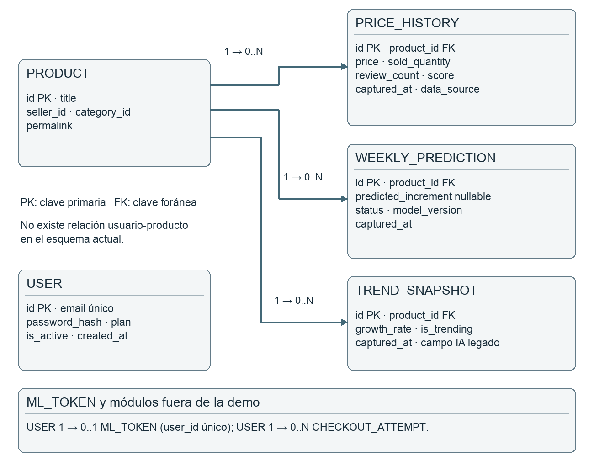
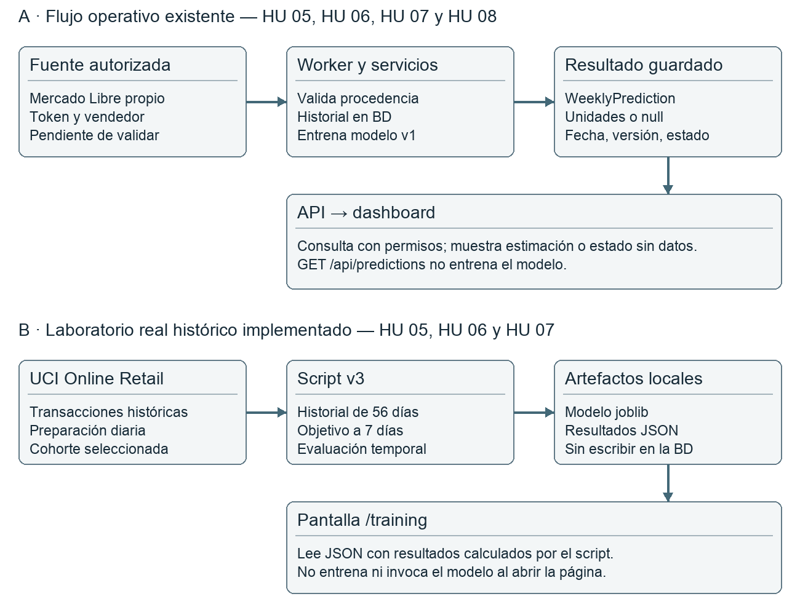
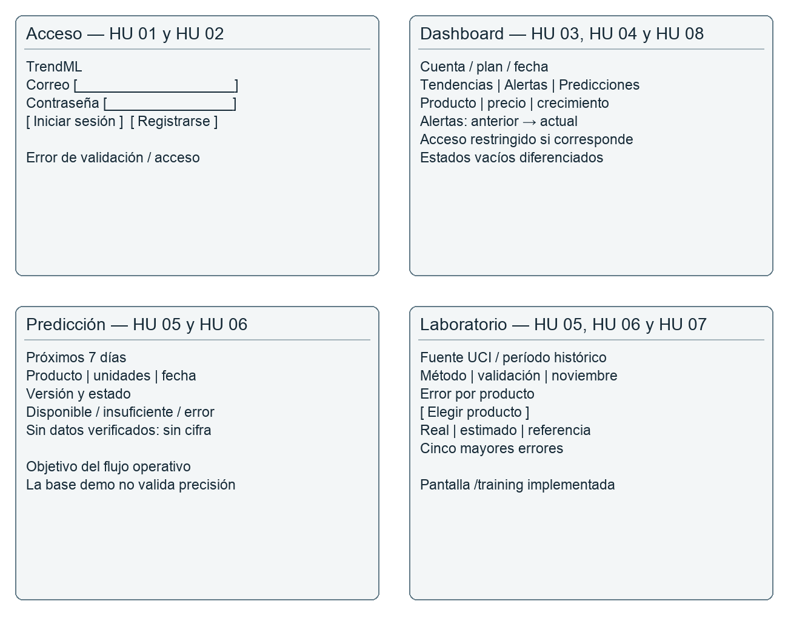

> **Documento histórico del 14 de octubre de 2026.** Describe el avance de los puntos 1 al 5 de ese momento. El estado de entrega actual, con pruebas y límites actualizados, está en `docs/entrega/`.

# TrendML Presentación de los puntos 1 al 5

Trabajo Práctico Integrador · Un sistema construido con IA, que además piensa con IA

Tecnicatura Superior en Ciencia de Datos e Inteligencia Artificial
Materia: Desarrollo de Software con Inteligencia Artificial
Estudiante: Jose Manuel Castro Reina
Docente: Matias Arellano
Grupo 14 · Modalidad individual autorizada, según confirmación del estudiante
Fecha de preparación: 14 de octubre de 2026

Presento el dominio elegido, la metodología, la organización del trabajo, ocho historias de usuario y el diseño actualizado de TrendML. El proyecto reutiliza una aplicación existente y añade correcciones, evaluación con datos históricos reales y documentación del proceso asistido por IA.

## 1 Elegir un dominio y una funcionalidad de IA embebida

Dominio: análisis de productos y ventas para pequeños vendedores de comercio electrónico. El problema es consultar cambios de precio y ventas y estimar cuántas unidades podrían venderse durante los próximos siete días para apoyar la planificación. La estimación orienta una revisión humana; no automatiza compras.

Funcionalidades priorizadas: registro y acceso, consulta de tendencias, alertas de precio y estimación semanal. Pagos, mensajería comercial y recomendaciones automáticas de compra quedan fuera de esta presentación.

### Los dos ejes de la consigna

- Software con IA: modelo propio de scikit-learn. El laboratorio calcula resultados sobre ventas históricas y los presenta en /training. La v3 corrige el promedio de cuatro semanas mediante boosting.

- Software asistido por IA: Codex colaboró en análisis, historias, diseño, correcciones de código, pruebas y documentación. La revisión y defensa del trabajo corresponden al estudiante.

Estado: hay un laboratorio histórico ejecutado, no una predicción comercial validada para Mercado Libre. Todavía no dispongo de cuenta vendedora ni ventas propias para comprobar ese flujo. Repositorio base: https://github.com/JoseManuel-TI/trendml . Los cambios recientes siguen locales y su publicación está pendiente.

## 2 Scrum Kanban o XP

Adopto Kanban por la modalidad individual y por trabajar sobre un sistema existente. Permite priorizar mejoras pequeñas, hacer visibles los bloqueos y finalizar una tarea antes de iniciar otra. No asigno roles Scrum ficticios ni afirmo haber realizado sprints.

### Responsabilidades y flujo

Jose Manuel Castro Reina asume análisis, priorización, desarrollo, pruebas, documentación y exposición. Codex es una herramienta de asistencia, no un integrante ni quien aprueba una tarea.

| Estado | Condición para ubicar una tarea |
| --- | --- |
| Backlog | Necesidad identificada, aún sin priorización o con dependencias pendientes. |
| Pendiente | Objetivo, criterios, responsable y dependencias definidos. |
| En proceso | Trabajo iniciado. Límite WIP de una tarjeta. |
| Finalizado | Resultado revisado, aceptación verificada y evidencia asociada. |

### Aplicación y revisión

El trabajo realizado siguió la secuencia: revisar el modelo heredado, corregir su horizonte y estados, obtener datos reales históricos, comparar versiones y preparar la exposición. Esta secuencia se reconstruye desde archivos y pruebas; no sustituye un historial de movimientos en una herramienta de gestión.

A partir de esta presentación, se propone revisar el tablero al iniciar y terminar cada sesión y hacer una revisión semanal del avance. Una tarjeta bloqueada indica motivo y siguiente acción. Los experimentos v1, v2 y v3 son tareas de una misma historia de IA, no funcionalidades independientes.

### Definición de terminado

- La tarea cumple sus criterios y tiene una evidencia identificable: archivo, prueba, resultado o captura.

- No se confunden datos sintéticos con reales ni errores técnicos con falta de permisos.

- Para IA: fecha, horizonte, fuente y versión claros; evaluación temporal y comparación con una referencia; límites documentados.

- La documentación está actualizada. Las tareas de código requieren revisión y commit asociado antes de cerrar su integración.

Uso de IA en esta etapa: propuesta de Kanban, WIP, dependencias y criterios de avance. Se ajustó a un único responsable y a las limitaciones reales del proyecto.

## 3 Trello Jira ClickUp Notion o Asana

Tablero privado creado en Notion el 14 de octubre de 2026, con 14 tarjetas y vista Kanban por estado. Registra el estado actual, no movimientos históricos. Las tres capturas siguen pendientes; el navegador solicita iniciar sesión. Enlace: https://app.notion.com/p/28314a0e971e47468ef7160884411574

### Resumen de tareas y evidencias actuales

| ID e historia | Tarea y subtareas | Estado verificable |
| --- | --- | --- |
| T01 · HU01–02 | Verificar registro, login y sesión inválida. | Pendiente de prueba funcional integral. |
| T02 · HU03–04 | Validar tendencias, baja de precio y casos vacíos. | Código existente; revisión funcional pendiente. |
| T03 · HU05–06 · IA | Corregir horizonte, última fila y estados de salida. | Código y pruebas locales; cierre de integración pendiente. |
| T04 · HU07 · IA | Preparar UCI; filtrar y registrar procedencia. | Ejecutado; scripts y datos disponibles. |
| T05 · HU05 · IA | Comparar v1, v2 y v3 con referencias. | Ejecutado; JSON, modelos e informes disponibles. |
| T06 · HU05–06 · IA | Mostrar métricas, filtros y errores por producto. | Verificado en navegador. |
| T07 · HU08 | Verificar permisos Starter y Pro en API. | Pendiente de prueba funcional integral. |
| T08 · Todas | Preparar documento, diagramas y guion. | Preparado; ensayo personal pendiente. |
| T09 · Todas | Crear tablero externo y capturar avances reales. | Tablero creado; primera captura pendiente. |
| T10 · Todas | Revisar cambios y publicar commits en GitHub. | Pendiente. |
| T11 · HU05–07 · IA | Evaluar datos nuevos y conexión a vendedor. | Backlog; faltan datos propios. |

Cada tarjeta incluye responsable, historia, tipo, evidencia, dependencias y trabajo a realizar. Hay 14 tarjetas: 3 en Backlog, 9 en Pendiente, 1 en En proceso y 1 Finalizada. La tarea finalizada corresponde a definir las ocho historias, no a implementar todas las funcionalidades. El cierre de código requiere revisión y commit.

### Capturas y trazabilidad

La primera captura debe tomarse al abrir el tablero con sesión iniciada. La segunda y tercera corresponden a sesiones posteriores con avances reales. El WIP de una tarea se aplica manualmente; Notion no impone automáticamente ese límite. Conservar las fechas reales de cada captura.

## 4 Mínimo ocho historias con criterios de aceptación

### HU 01 Registro

Como vendedor quiero crear una cuenta para que pueda acceder a las herramientas de análisis.

- Dado un correo válido no registrado, cuando envío datos válidos, entonces se crea una única cuenta.

- Dado un correo duplicado o datos inválidos, cuando envío el formulario, entonces se rechaza la solicitud sin duplicar la cuenta.

- La contraseña se guarda como hash y no se devuelve en la respuesta.

### HU 02 Acceso

Como vendedor quiero iniciar sesión para que pueda consultar los análisis habilitados para mi cuenta.

- Dadas credenciales válidas, cuando ingreso, entonces obtengo una sesión y puedo consultar mi cuenta.

- Dadas credenciales inválidas o una sesión vencida, cuando solicito información protegida, entonces la API rechaza el acceso.

### HU 03 Tendencias

Como vendedor quiero consultar productos con crecimiento observado para que pueda detectar oportunidades para investigar.

- Dado un historial válido, cuando consulto tendencias, entonces veo producto, precio, crecimiento y fecha según un cálculo documentado.

- Dado un conjunto vacío, cuando consulto, entonces se informa ausencia de datos y no una restricción de permisos.

- El crecimiento se identifica como cálculo convencional, no como IA.

### HU 04 Alertas de precio

Como vendedor quiero identificar bajas de precio para que pueda revisar cambios relevantes en productos.

- Dadas dos observaciones comparables y una baja, cuando consulto, entonces veo precio anterior, actual y porcentaje de cambio.

- Dado precio anterior cero o historial insuficiente, cuando se procesa, entonces no se divide por cero ni se inventa una comparación.

## 4 Historias de IA datos y permisos

### HU 05 Estimación semanal con IA

Como vendedor quiero ver una estimación de unidades para los próximos siete días para que pueda orientar mi planificación de stock.

- Dado un historial válido y un modelo entrenado, cuando se procesa, entonces se calcula una salida no negativa con horizonte y fecha.

- Dada una observación final sin venta futura conocida, cuando se infiere, entonces se usa esa última observación válida y no una fila anterior.

- La evaluación informa error frente a referencias y distingue resultados históricos de una estimación futura no validada.

### HU 06 Disponibilidad de la predicción

Como vendedor quiero conocer la disponibilidad y las limitaciones de una estimación para que pueda interpretarla correctamente.

- Dado historial insuficiente o sin fuente verificada, cuando consulto, entonces se indica el estado sin presentar un número como predicción válida.

- Dado un fallo del modelo, cuando se procesa, entonces se informa el error y el resto de la aplicación sigue disponible.

- La pantalla distingue error, falta de datos y falta de permisos.

### HU 07 Incorporación de datos

Como operador quiero incorporar observaciones fechadas y trazables para que los análisis utilicen información identificable.

- Dado un archivo real admitido, cuando lo preparo, entonces quedan producto, fecha, cantidades y procedencia identificados.

- Dados registros inválidos, cuando se procesan, entonces se excluyen con reglas documentadas y se informa el resumen de preparación.

- Los datos sintéticos se etiquetan; no se presentan como evidencia de mercado real.

### HU 08 Permisos

Como vendedor quiero conocer las funcionalidades habilitadas para mi cuenta para que pueda entender a qué análisis tengo acceso.

- Dada una cuenta Starter, cuando solicita una función Pro, entonces la API rechaza el acceso y se informa la restricción.

- Dada una cuenta de prueba con permisos suficientes, cuando consulta el análisis protegido, entonces puede acceder sin efectuar un pago en la demo.

- Cambiar una etiqueta en el navegador no otorga permisos en la API.

Los criterios describen la aceptación requerida; no implican que todos los flujos estén verificados de extremo a extremo. HU 05–07 cuentan con evidencia del laboratorio; HU 01–04 y HU 08 requieren completar pruebas funcionales del recorrido operativo.

## 5 Diagrama de clases o ER más wireframes y diseño de IA

### Arquitectura y entidades

La interfaz Next.js consulta una API FastAPI. SQLAlchemy gestiona la base; el entorno local usa SQLite y existe configuración para PostgreSQL. El worker captura y procesa observaciones. El laboratorio académico ejecuta scripts Python y publica resultados JSON que lee la interfaz.

PriceHistory conserva la procedencia. WeeklyPrediction guarda unidades estimadas o null, estado, versión y fecha, con unicidad por producto y fecha. El campo IA legado de TrendSnapshot se conserva por compatibilidad, pero la API de predicciones consulta WeeklyPrediction.

El esquema actual no vincula cada producto a un usuario de la aplicación. Aislar datos por vendedor es una mejora pendiente para uso multiusuario real. Tokens y pagos se incluyen solo como contexto del proyecto heredado; no se muestran secretos en la demo.

## 5 Diseño del componente de IA

### Contrato de la versión 3

Entrada: 56 días consecutivos de ventas y precios, sin incluir información posterior al instante de estimación. Variables: ventas recientes, días sin ventas, variabilidad, tendencia y calendario. Entrenamiento: el objetivo es la suma de unidades de los siete días siguientes; solo se usa si ya se conoce al corte.

Salida: una corrección al promedio de cuatro semanas, reconstruida a unidades y limitada a valores no negativos. El script guarda el modelo, los casos y las métricas. La pantalla consume ese JSON; abrir /training no llama al modelo ni lo entrena.

La demo puede ejecutar scripts/train_uci_v3.py con el archivo UCI preparado y recargar la pantalla. Esto demuestra cálculo reproducible sobre datos históricos reales. No demuestra acceso a una cuenta de Mercado Libre ni predicción validada en el mercado actual.

## 5 Wireframes de las pantallas principales

Los siguientes esquemas son wireframes de diseño, no capturas de evidencia. El acceso y el dashboard corresponden al producto operativo; el laboratorio permite revisar la calidad de la IA. La carga de HU 07 se realiza por scripts o worker, sin inventar una pantalla de importación.

### Recorrido propuesto

1. Explicar acceso y permisos. 2. Mostrar tendencias y alertas como cálculos convencionales. 3. Explicar el estado sin predicción válida cuando la fuente es demo. 4. Abrir /training y mostrar métodos, error y casos reales. La comprobación de login y permisos debe completarse antes de una demo integral.

## Trazabilidad y registro de asistencia con IA

| Historias | Diseño y archivos principales | Evidencia o límite |
| --- | --- | --- |
| HU01–02 | USER; /register y /login; backend/api/auth.py | Código existente; falta prueba integral actual. |
| HU03–04 | PRODUCT, PRICE_HISTORY, TREND_SNAPSHOT; dashboard | Cálculos convencionales; validación funcional pendiente. |
| HU05–06 | WEEKLY_PREDICTION; ml_service.py; /training | Pruebas técnicas, tres experimentos, interfaz revisada. |
| HU07 | prepare_uci.py; worker/data_collector.py | UCI ejecutado; vendedor propio pendiente. |
| HU08 | USER.subscription_plan; backend/api/analytics.py | Permisos en API; falta ensayo por plan. |

### Registro de uso de Codex

| Etapa | Asistencia y revisión aplicada |
| --- | --- |
| Análisis | Comparación de proyectos y formulación de historias. El estudiante eligió TrendML. |
| Gestión | Kanban, WIP y tareas. Se creó un tablero privado en Notion; sus capturas de avance siguen pendientes. |
| Diseño | ER y flujos basados en código. Se actualizó el diseño para incluir WeeklyPrediction y separar laboratorio y operación. |
| Desarrollo | Corrección del objetivo temporal, estados y scripts v1–v3. Se mantuvo la procedencia de datos y se descartaron alternativas numéricas presentadas como IA. |
| Pruebas | Generación y ejecución de pruebas; análisis de error temporal y comparación con referencias. Los resultados no garantizan calidad comercial. |

### Estado y evidencias para explicar al docente

26 pruebas unitarias aprobadas y comprobación TypeScript sin errores en la última verificación. En v3, el MAE fue 374,26 unidades por producto y semana frente a 380,00 de la referencia en agosto–octubre. En noviembre fue 479,06 frente a 492,77. La mejora es pequeña y los períodos ya fueron consultados: falta una evaluación independiente.

Punto 3: tablero de Notion creado y tarjetas confirmadas; faltan capturas de tres momentos reales. También quedan pendientes publicar cambios, completar las pruebas convencionales y validar datos nuevos. Esta presentación cubre un avance de los puntos 1 al 5; no declara finalizado el integrador.

Fuentes: consigna aportada por el estudiante; código local y docs/ENTRENAMIENTO_UCI_V3.md; resultados JSON y pruebas. Datos: UCI Online Retail, Daqing Chen (2015), DOI 10.24432/C5BW33, CC BY 4.0 — https://archive.ics.uci.edu/dataset/352/online+retail .
