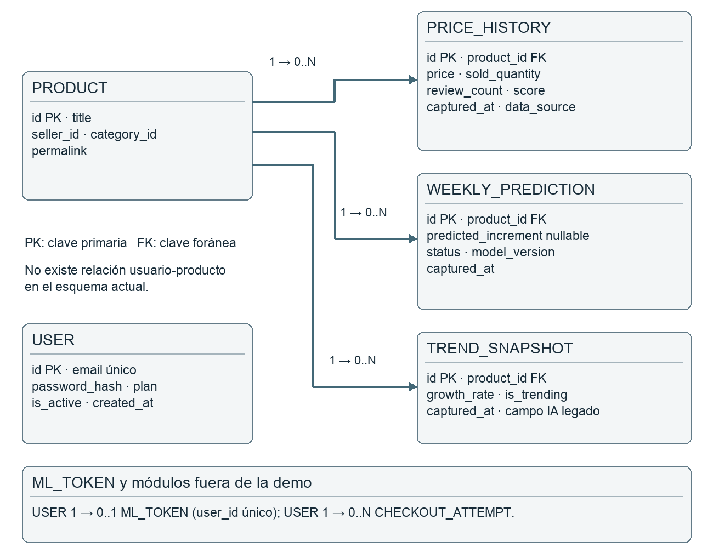
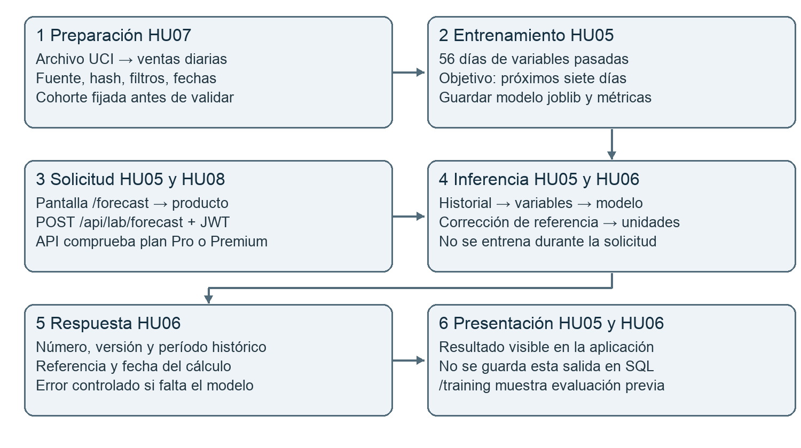
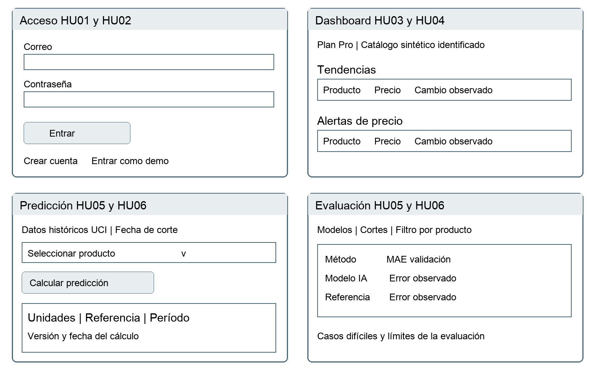

# TrendML informe del proyecto integrador

Jose Manuel Castro Reina · Grupo 14 individual
Docente Matias Arellano
Desarrollo de Software con Inteligencia Artificial
31 de octubre de 2026 · Revisión de entrega: 6 de noviembre de 2026

TrendML permite consultar tendencias y cambios de precio y ejecutar una estimación semanal con IA. La versión académica implementa registro, acceso, análisis convencional, permisos e inferencia visible. Combina una demostración sintética con un laboratorio histórico real; la estimación todavía no está validada para decisiones comerciales actuales.

## 1 Dominio y alcance

El usuario objetivo es un pequeño vendedor que necesita revisar productos y planificar stock. La IA aporta una estimación de unidades para siete días desde una fecha de corte. Su salida requiere revisión humana. Se reutiliza una aplicación existente y se corrigen su objetivo temporal, sus estados y la integración del modelo.

Software con IA: scikit-learn ejecutado por la API al pulsar Calcular predicción. Software asistido por IA: Codex colaboró en análisis, gestión, diseño, desarrollo y pruebas. La modalidad individual fue autorizada por el docente según confirmación del estudiante.

## 2 Metodología aplicada

Kanban con un responsable: Jose Manuel Castro Reina. Flujo Backlog, Pendiente, En proceso y Finalizado; WIP máximo de una tarjeta. Se priorizó revisar datos y modelo, ejecutar experimentos, integrar inferencia, verificar recorridos y preparar la entrega. No se simulan roles Scrum ni sprints retrospectivos.

**Roles:** al ser modalidad individual autorizada, Jose asume análisis, desarrollo, pruebas, documentación y presentación; Codex se usó como herramienta de apoyo y no como integrante. **Eventos de trabajo aplicados:** elegir/priorizar la siguiente tarjeta cuando el WIP lo permite; revisar el tablero al cerrar una sesión o hito; comprobar criterios, pruebas y evidencia antes de pasar código a Finalizado. No se afirma haber realizado reuniones diarias ni ceremonias de Scrum.

Terminado significa criterios cumplidos, pruebas pertinentes ejecutadas, evidencia, revisión y commit para código. El tablero se actualiza al cerrar hitos. Las capturas se registran con la fecha real de la sesión; no reconstruyen fotografías de etapas anteriores.

Tablero: https://app.notion.com/p/28314a0e971e47468ef7160884411574
Repositorio y rama de entrega: https://github.com/JoseManuel-TI/trendml/tree/codex/entrega-academica

## 3 Organización del trabajo

Las tarjetas T01–T07 cubren funcionalidades, datos y evaluación; T08 la exposición; T09 y T13 la evidencia del tablero; T10 publicación; T11 y T12 la futura validación comercial. Las tareas IA se identifican con su etiqueta. La publicación remota y el ensayo oral se verifican por separado del código local.

## 4 Historias de usuario y aceptación

### HU01 Registro

Como vendedor quiero crear una cuenta para que pueda acceder a las herramientas de análisis.

Aceptación: Correo válido y contraseña de 8 a 128 caracteres crean una cuenta Starter. Correo duplicado devuelve 409; entrada inválida devuelve 422. Se almacena hash y nunca se devuelve la contraseña.

Trazabilidad: backend/api/auth.py; test_registration_duplicate_validation_and_hash

### HU02 Acceso

Como vendedor quiero iniciar sesión para que pueda consultar mis funcionalidades habilitadas.

Aceptación: Credenciales válidas producen JWT. Credenciales erróneas o usuario inactivo se rechazan. Token inválido no permite leer datos protegidos.

Trazabilidad: backend/auth/deps.py; test_login_invalid_session_and_inactive_user

### HU03 Tendencias

Como vendedor quiero consultar productos con crecimiento observado para que pueda detectar oportunidades para investigar.

Aceptación: Se presenta el último snapshot por producto, con precio, fecha y crecimiento. El conjunto vacío tiene un mensaje explícito. El crecimiento es cálculo convencional.

Trazabilidad: backend/services/analytics_service.py; test_price_drop_and_latest_trend_only

### HU04 Alertas

Como vendedor quiero identificar bajas de precio para que pueda revisar cambios relevantes.

Aceptación: Dos observaciones comparables muestran precio anterior, actual y porcentaje. Precio base cero o historial insuficiente no produce una alerta inventada. Un Pro sin alertas ve ausencia de datos, no una restricción de plan.

Trazabilidad: /dashboard; test_price_drop_and_latest_trend_only

### HU05 Estimación con IA

Como vendedor quiero ver una estimación de unidades para siete días para que pueda orientar mi planificación.

Aceptación: Un producto del catálogo UCI y plan Pro ejecutan el modelo guardado. La respuesta no negativa muestra fecha de corte y período. El número no se presenta como estimación de la semana actual.

Trazabilidad: /forecast; test_real_saved_model_inference

### HU06 Disponibilidad

Como vendedor quiero conocer el estado y las limitaciones de una estimación para que pueda interpretarla correctamente.

Aceptación: Modelo ausente devuelve 503 y mensaje legible; producto desconocido devuelve 404. Datos demo del circuito operativo producen estado no verificado y ninguna cifra válida. La respuesta incluye fuente, versión, corte de inferencia, fecha máxima de entrenamiento, cantidad de pares y MAE de desarrollo; la interfaz los muestra en una ficha técnica.

Trazabilidad: api/forecast.py; services/forecast_service.py; test_live_inference_permissions_and_missing_model; test_real_saved_model_inference

### HU07 Datos trazables

Como operador quiero incorporar observaciones fechadas y trazables para que los análisis utilicen información identificable.

Aceptación: El script prepara UCI conservando fuente, hash, fechas y reglas de filtrado. Rechaza series diarias inconsistentes, vacías o con valores negativos/no finitos. No se ofrece una carga de ventas privadas por web.

Trazabilidad: prepare_uci.py; train_uci_v2.py; tests de pipeline y adversarios

### HU08 Permisos

Como vendedor quiero conocer las funciones habilitadas para mi cuenta para que pueda entender mi acceso.

Aceptación: Starter no calcula predicciones ni consulta alertas Pro. Los permisos se revisan en API. Premium no implica administrador. El checkout se bloquea en modo académico.

Trazabilidad: test_plans_empty_data_and_admin_is_not_premium; test_academic_mode_disables_checkout

## 5 Diseño de datos y arquitectura

Next.js y React presentan las pantallas; FastAPI valida sesiones y permisos; SQLAlchemy utiliza SQLite para la demo. El laboratorio lee un JSON de observaciones preparado y un artefacto joblib. Los componentes heredados de pagos y Mercado Libre no forman parte de la validación comercial.

HU01–02 y HU08 se relacionan con User. HU03–04 utilizan Product, PriceHistory y TrendSnapshot. HU05–06 del circuito operativo conservan resultados en WeeklyPrediction. HU07 registra procedencia en PriceHistory y en los metadatos de UCI.

La inferencia histórica bajo demanda utiliza archivos, no WeeklyPrediction: la respuesta se muestra directamente. El catálogo académico es compartido; no se cargan datos privados de vendedores. El aislamiento por vendedor queda pendiente para una versión multiempresa.

## 6 Integración de IA

La API recibe únicamente un identificador del catálogo histórico. Carga el modelo local confiable y calcula variables de la última observación válida; no recibe rutas joblib externas. La predicción se reconstruye como máximo entre cero y referencia más corrección escalada. Se comprueba finitud de la salida.

El artefacto y la respuesta conservan procedencia verificable: hash del archivo UCI, versión y método, fecha de corte, fecha máxima de los objetivos usados al entrenar, cantidad de pares, MAE de validación y MAE de la referencia de cuatro semanas. El servicio rechaza un modelo entrenado con objetivos posteriores a su corte de inferencia o construido con otro archivo de datos.

Entrenamiento: cada etiqueta suma los siete días posteriores, y solo entra al ajuste si era conocida en el corte. La validación se realiza en agosto, septiembre y octubre de 2011; noviembre se informa como comparación exploratoria ya inspeccionada. El artefacto final usa todos los pares históricos conocidos.

Métricas reproducidas: MAE 374,26 unidades por producto y semana frente a 380,00 del promedio de cuatro semanas en validación. Noviembre: 479,06 frente a 492,77. La mejora es pequeña y no uniforme. No se declara una precisión porcentual ni una prueba independiente.

## 7 Pantallas y recorrido

Son wireframes de diseño. El recorrido ejecutado fue Login demo → Dashboard → Predecir → Calcular predicción. La pantalla mostró 496,6 unidades para PACK OF 12 LONDON TISSUES, con corte 08/12/2011 y horizonte 09–15/12/2011. La referencia fue 674,5 unidades. El cálculo ocurrió el 31/10/2026, pero las ventas son históricas.

La captura demo-inferencia.png registra el recorrido. Los diez productos se ejecutaron además contra el servicio real y sus respuestas están en inferencias.json. El resultado futuro de ese horizonte no se conoce en el conjunto recortado y no se usa para afirmar precisión.

## 8 Implementación y pruebas

La entrega contiene registro y acceso, tendencias, alertas, permisos y una inferencia genuina integrada. Las 37 pruebas automatizadas terminaron correctamente; incluyen base aislada, permisos, cálculo convencional, datos, separación temporal, fallos y artefacto real. Next.js compiló correctamente. No se ejecutaron cobros ni envíos de correo. El plan, los diez casos de calidad de IA, los adversarios y el recorrido HTTP están detallados en `Plan-de-pruebas.md`.

### Diez casos de calidad del modelo

Una entrada por producto en el primer origen de noviembre (01/11/2011), horizonte siete días. Criterio comparativo: favorable si el error absoluto del modelo no supera el de la referencia de cuatro semanas. No es un umbral de aceptación comercial. Se incluyen todos los productos, sin escoger solo aciertos.

| Producto | Real | IA | Error IA | Error ref. | Favorable |
| --- | --- | --- | --- | --- | --- |
| UCI-15036 | 41 | 166.7 | 125.7 | 107.5 | No |
| UCI-21212 | 1092 | 576.5 | 515.5 | 596.2 | Sí |
| UCI-21977 | 108 | 365.7 | 257.7 | 245.0 | No |
| UCI-22197 | 2843 | 1105.4 | 1737.6 | 1361.2 | No |
| UCI-22616 | 791 | 369.7 | 421.3 | 423.2 | Sí |
| UCI-23166 | 39 | 65.1 | 26.1 | 20.5 | No |
| UCI-84077 | 1296 | 1041.7 | 254.3 | 633.8 | Sí |
| UCI-84879 | 634 | 656.4 | 22.4 | 82.5 | Sí |
| UCI-85099B | 1179 | 941.9 | 237.1 | 163.5 | No |
| UCI-85123A | 1708 | 426.5 | 1281.5 | 1292.8 | Sí |

Entradas detalladas y resultados: evaluation-v3.json y frontend/public/training-results-v3.json. Adversarios: serie vacía, unidades negativas, NaN e infinito son rechazados; producto inexistente produce 404; modelo ausente produce 503 sin romper el resto de la aplicación.

### Bugs encontrados y corregidos

Validación de contraseña solo en frontend → validación en API. Snapshots antiguos duplicados → último por producto. Lista vacía de alertas confundida con permisos → estados separados. Premium accedía a datos administrativos → lista explícita de administradores. Resultados estáticos sin inferencia desde UI → nueva API y pantalla. Dependencia openpyxl ausente → instalación fijada y entrenamiento reproducido.

## 9 Registro y análisis de herramientas de IA

Cobertura mínima: Análisis, Gestión, Diseño, Desarrollo y Pruebas. Se añade una fila para la herramienta de IA del producto.

| Herramienta | Etapa | Para qué se usó | Resultado obtenido | ¿Tal cual o ajustado? |
| --- | --- | --- | --- | --- |
| Codex | Análisis | Seleccionar el sistema y redactar el borrador de las ocho historias de usuario. | Historias HU01–HU08 y alcance académico inicial. | Ajustado: se recortó el alcance, se fijó el trabajo individual y se añadieron criterios verificables. |
| Codex | Gestión | Definir el flujo Kanban, el WIP 1, las tarjetas T01–T13 y los documentos de entrega. | Tablero y checklist ligados a evidencia. | Ajustado: se eliminaron sprints y fechas inventadas; cada estado exige prueba o commit. |
| Codex | Diseño | Proponer el ER, los wireframes y el circuito de integración de IA. | Diagramas `er.png`, `wireframes-actuales.png` y `flujo-ia.png`. | Ajustado: se separó el laboratorio histórico de las predicciones operativas y se corrigieron entradas y salidas. |
| Codex | Desarrollo | Revisar y corregir la API de inferencia, la interfaz y el manejo de errores. | Código de `/forecast`, `forecast_service.py` y estados de error. | Ajustado: los cambios se contrastaron con el código y recorridos HTTP reales; se corrigió un error JSX. |
| Codex | Pruebas | Generar casos de aceptación, adversarios y análisis de errores del modelo. | 37 pruebas automatizadas y tabla de diez casos de calidad. | Ajustado: se ejecutaron y revisaron; se descartaron afirmaciones sin evidencia. |
| scikit-learn | Producto (IA) | Entrenar el modelo de boosting residual para estimar siete días. | `weekly-model-v3.joblib` con MAE 374,26 frente a 380,00 de referencia. | Ajustado: se declara mejora pequeña, no uniforme y no validada comercialmente. |

**Mayor valor:** la asistencia con IA aportó más valor al detectar inconsistencias entre el objetivo declarado y el cálculo real. Predecir un registro posterior no equivale automáticamente a predecir siete días: fue necesario definir fechas y etiquetas. También ayudó a convertir requisitos en pruebas que permiten revisar si la aplicación cumple lo esperado.

**Correcciones y descartes:** las propuestas requirieron correcciones. Se descartó presentar una serie sintética o un valor de respaldo como una predicción comercial. Se corrigió la confusión entre cargar resultados JSON y ejecutar el modelo. Durante la integración surgió un error de sintaxis JSX, detectado por la compilación y reparado antes de validar la interfaz. La revisión humana y las pruebas siguen siendo necesarias.

**Cambio en la forma de trabajar:** el proceso quedó organizado en tareas pequeñas con evidencia reproducible. El estudiante debe revisar los cambios y practicar su explicación: generar documentación no demuestra por sí mismo comprensión. La IA acelera borradores y búsqueda de errores, pero puede producir código o afirmaciones incorrectas.

**Limitaciones y trabajo futuro:** la principal limitación del modelo es la distancia entre el conjunto histórico británico y el mercado donde se pretende usar TrendML. La mejora media frente a una referencia simple es pequeña; algunos productos presentan errores altos. Con más tiempo, incorporaría ventas propias autorizadas, disponibilidad de stock, evaluación temporal independiente, monitoreo y aislamiento por vendedor antes de una aplicación comercial.

## Entrega y reproducción

1. Instalar: bash scripts/setup_local.sh
2. Preparar y entrenar: bash scripts/train_academic.sh
3. Verificar: bash scripts/check_academic.sh
4. Iniciar: bash scripts/start_academic.sh
5. Abrir http://localhost:3000/login y pulsar Entrar como demo.

Cuenta Pro local: demo@example.com / DemoTrendML123!
Cuenta Starter local: starter@example.com / DemoTrendML123!
Son credenciales públicas de prueba. La base work/academic.db está separada del entorno anterior; el servidor escucha solo en el equipo local.

### Materiales

Informe-final.docx: documento académico. Exposicion-clases.docx: guion independiente. Plan-de-pruebas.md: plan y resultados, casos de IA y adversarios. Checklist-entrega.md: estado de requisitos y pendientes. Tablero-actualizaciones.md: estado registrado del tablero. pruebas.txt: resultados de tests. inferencias.json: diez respuestas del modelo real con metadatos. demo-inferencia.png: evidencia visual. tablero-01.png, tablero-02.png y tablero-03.png: tres estados reales del Kanban (31/10/2026 y 01/11/2026).

### Control final de entrega

El documento y el código local no sustituyen la carga en el aula ni el ensayo oral. La rama final ya está publicada y las tres capturas reales del tablero están guardadas. Antes de entregar, verificar el enlace remoto y ensayar la demostración. Las capturas de cierre tomadas en una misma sesión no representan etapas de semanas anteriores.

### Fuentes y atribución

Consigna del Trabajo Práctico Integrador aportada por el estudiante. Código y pruebas del repositorio TrendML. UCI Online Retail, Daqing Chen (2015), DOI 10.24432/C5BW33, licencia CC BY 4.0; https://archive.ics.uci.edu/dataset/352/online+retail. Se transformaron transacciones en observaciones diarias, excluyendo cancelaciones, devoluciones y registros no elegibles. Los días sin transacciones elegibles no prueban disponibilidad de stock.

El cierre indicado en la consigna es el 30 de noviembre de 2026 a las 23:59. El turno de exposición debe confirmarse con el docente. El uso comercial requiere validaciones adicionales; pagos, correo, Mercado Libre y PostgreSQL productivo no fueron verificados en esta entrega local.
